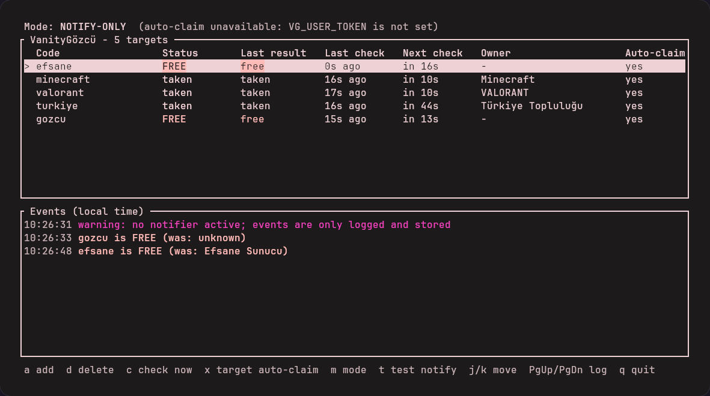

# VanityGözcü

Discord vanity URL'lerini (`discord.gg/xxx`) izleyen Rust aracı. URL boşalınca Discord webhook ve Telegram üzerinden bildirim gönderir; isteğe bağlı olarak URL'yi kendi sunucuna almayı dener. `ratatui` tabanlı TUI ile yönetilir, systemd servisi olarak headless çalışabilir.



*TUI görünümü (yerel sahte API ile örnek veriler).*

## Özellikler

- **İzleme:** Önerilen en fazla 25 vanity kodunu düzenli aralıklarla kontrol eder.
- **Bildirim:** URL boşalınca Discord webhook ve/veya Telegram mesajı.
- **Otomatik alma (opsiyonel, varsayılan kapalı):** Kullanıcı token'ıyla URL'yi hedef sunucuya atamayı dener.
- **TUI:** Durum tablosu, olay günlüğü, hedef ekleme/çıkarma, mod değiştirme.
- **Headless mod:** `daemon` olarak systemd servisi şeklinde çalışır; `attach` ile TUI'ye bağlanılır.
- **Rate limit:** Discord'un `Retry-After` ve `X-RateLimit-*` başlıklarına uyar.

## Önemli uyarı

Bildirim modu kullanıcı hesabı token'ı gerektirmez.

Otomatik alma modu **kullanıcı hesabı token'ı** kullanır. Kullanıcı hesabını otomasyonla kullanmak (self-bot) Discord Hizmet Şartları'na aykırıdır ve hesabın kapatılmasına yol açabilir. Bu modu bilerek aç; mümkünse ana hesap yerine riski kabul ettiğin bir hesap kullan. Araç MFA veya captcha doğrulamalarını **aşmaya çalışmaz**; böyle bir istekte durur ve bildirim gönderir.

## Hızlı başlangıç

```bash
cargo build --release
cp config.example.toml config.toml        # düzenle
export VG_TELEGRAM_TOKEN=...               # gizli bilgiler ortam değişkeninden okunur
export VG_DISCORD_WEBHOOK=...
./target/release/vanity-gozcu run          # izleme + TUI tek süreçte
```

Otomatik alma için ayrıca `VG_USER_TOKEN` ve config'de `[auto_claim]` ayarları gerekir.

## Komutlar

| Komut | Ne yapar |
|---|---|
| `run` | İzlemeyi başlatır ve TUI'yi aynı süreçte açar. Çıkınca izleme de durur. |
| `daemon` | TUI'siz çalışır, günlük dosyasına yazar ve `socket_path` üzerinde `attach` bağlantılarını bekler. |
| `attach` | Çalışan bir `daemon`'a bağlanıp TUI açar. TUI'den çıkmak daemon'ı durdurmaz. |
| `check <kod>` | Tek bir kodu bir kez kontrol edip sonucunu yazdırır. |
| `test-notify` | Etkin bildirim kanallarına test mesajı gönderir. |

Bir `daemon` çalışırken `run` başlamaz (iki motor aynı config ve veritabanına yazmasın diye); `attach` kullanmanız söylenir.

Socket dosyası `0600` izinlidir, yalnızca aynı kullanıcı bağlanabilir ve daemon kapanınca silinir. Protokol satır başına bir JSON mesajıdır, örnek: `{"id":1,"cmd":"get_snapshot"}`.

### Arka planda çalıştırma (tmux gerekmez)

```bash
./target/release/vanity-gozcu daemon &
./target/release/vanity-gozcu attach      # istediğin zaman bağlan, q ile ayrıl
```

`attach` ile yapılan hedef ekleme/silme ve mod değişiklikleri daemon tarafından config'e yazılır.

## VDS'e kurulum

Aracın Discord'a erişebildiği bir ülkede bir Linux VDS seçin. Kurulum betiği systemd servisini kurar:

```bash
cargo build --release
sudo sh deploy/install.sh
```

Betik `vanity` sistem kullanıcısını, `/opt/vanity-gozcu/{data,logs}` dizinlerini, ikiliyi, örnek config'i (`data/config.toml`, varsa dokunmaz), boş bir `/etc/vanity-gozcu/env` şablonunu (mod `600`) ve systemd birimini kurar. Servisi **başlatmaz**. Ardından:

1. `/opt/vanity-gozcu/data/config.toml` dosyasını düzenleyin (hedefler, bildirim kanalları).
2. `/etc/vanity-gozcu/env` dosyasına gizli bilgileri yazın.
3. `systemctl enable --now vanity-gozcu`
4. Canlı izleme:

```bash
cd /opt/vanity-gozcu && sudo -u vanity env VG_CONFIG=/opt/vanity-gozcu/data/config.toml ./vanity-gozcu attach
```

Loglar: `journalctl -u vanity-gozcu -f` ve `/opt/vanity-gozcu/logs/`.

## Belgeler

| Dosya | İçerik |
|---|---|
| [MIMARI.md](MIMARI.md) | Modüller, veri akışı, durum makinesi |
| [YAPILANDIRMA.md](YAPILANDIRMA.md) | `config.toml` alanları ve ortam değişkenleri |
| [GUVENLIK.md](GUVENLIK.md) | Token yönetimi, loglama, risk sınırları |
| [YOL_HARITASI.md](YOL_HARITASI.md) | Geliştirme planı |
| [PROMPT.md](PROMPT.md) | Projeyi bir AI kod asistanına yazdırmak için prompt |

## Lisans

[MIT](LICENSE)
